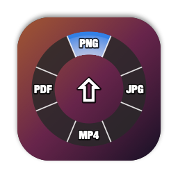
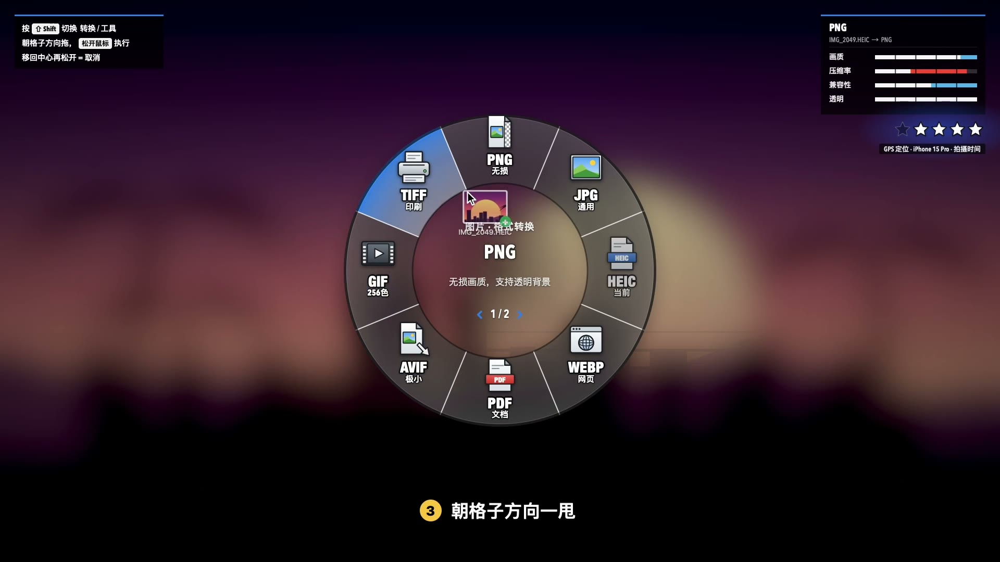
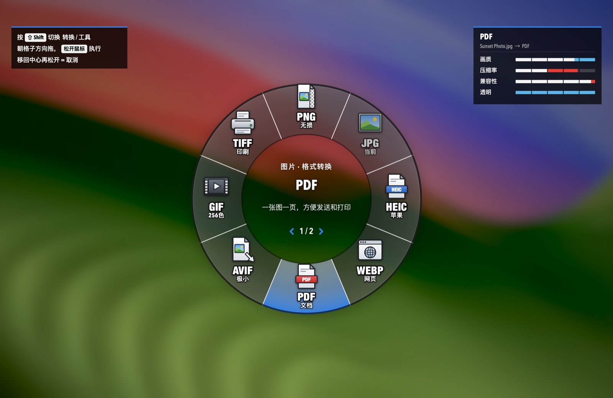
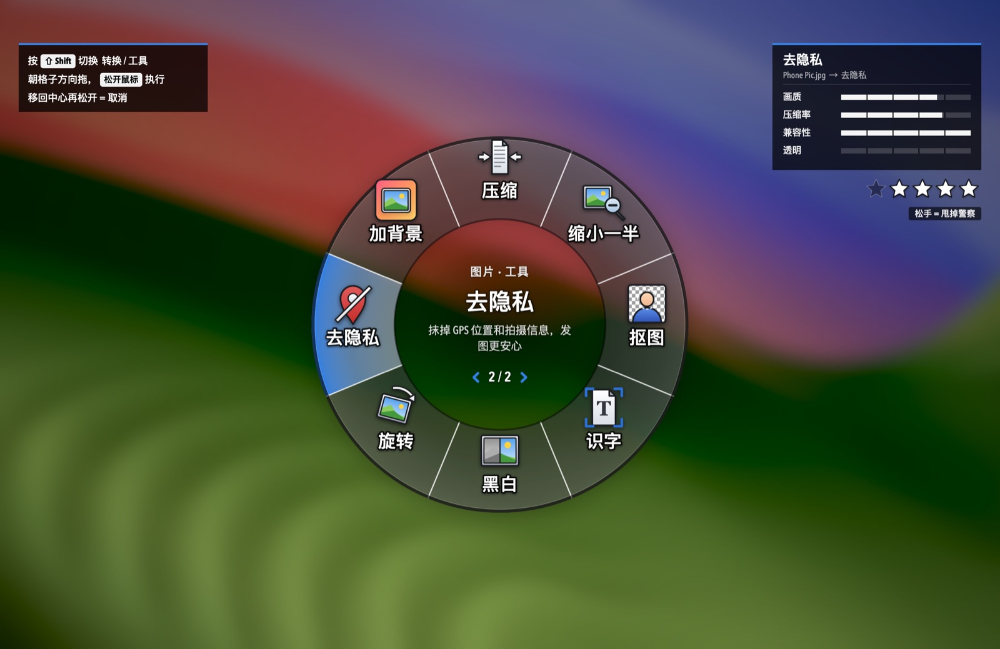
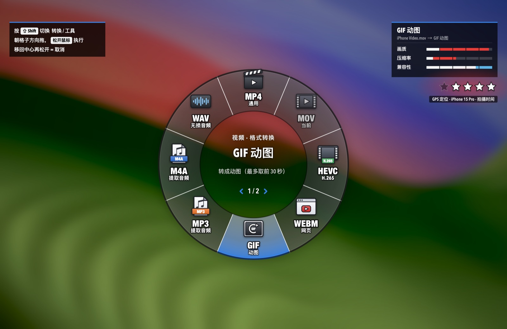
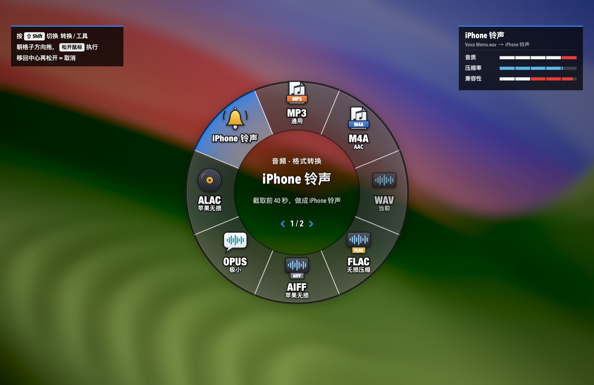
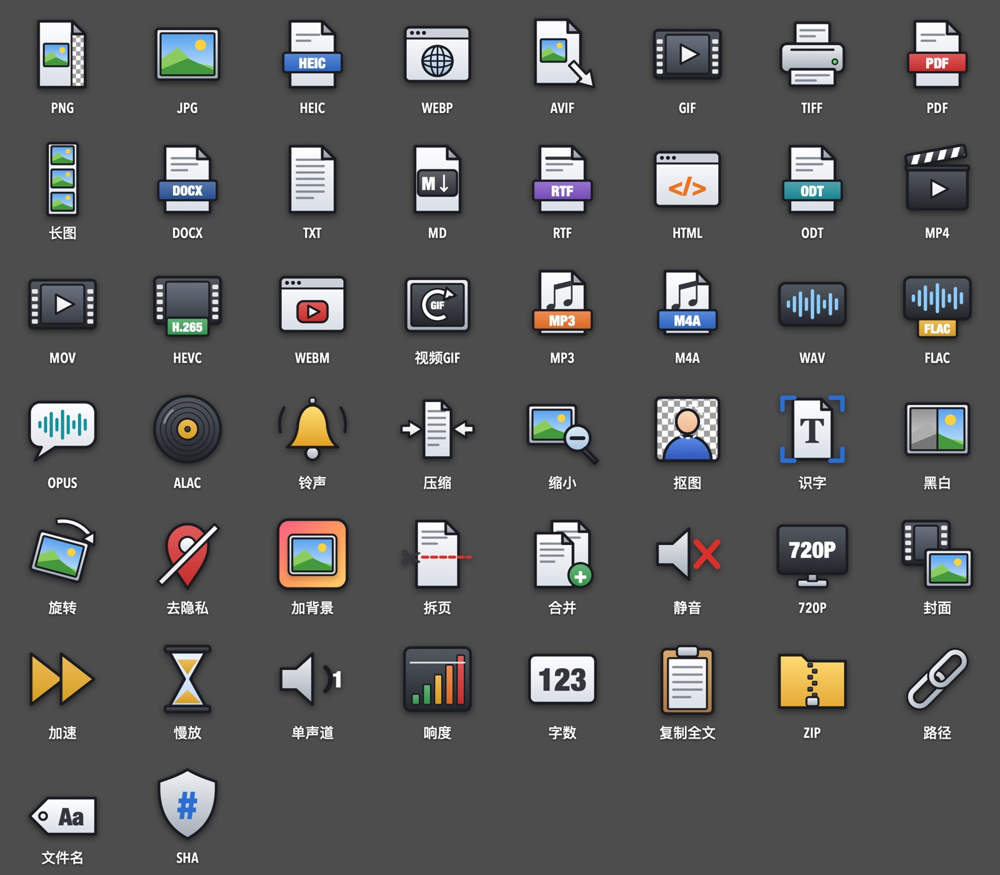
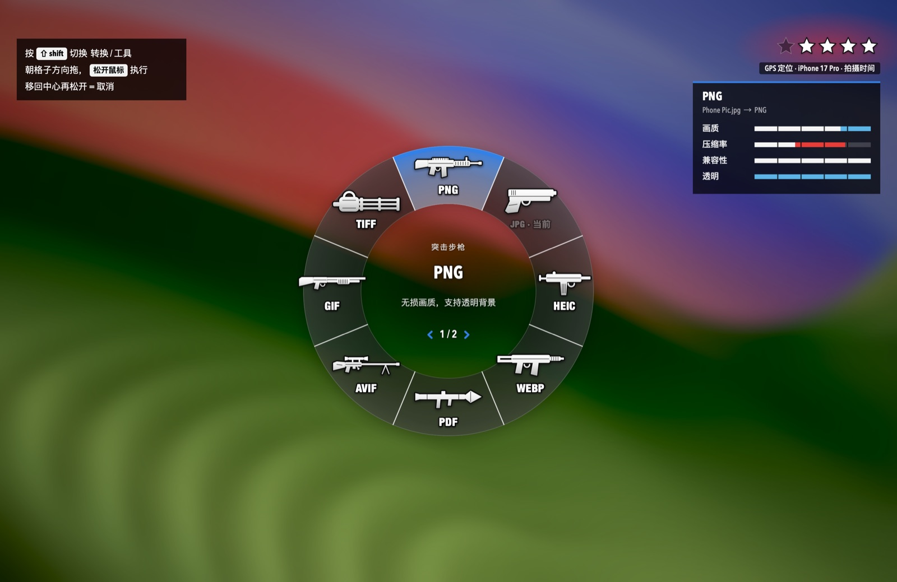
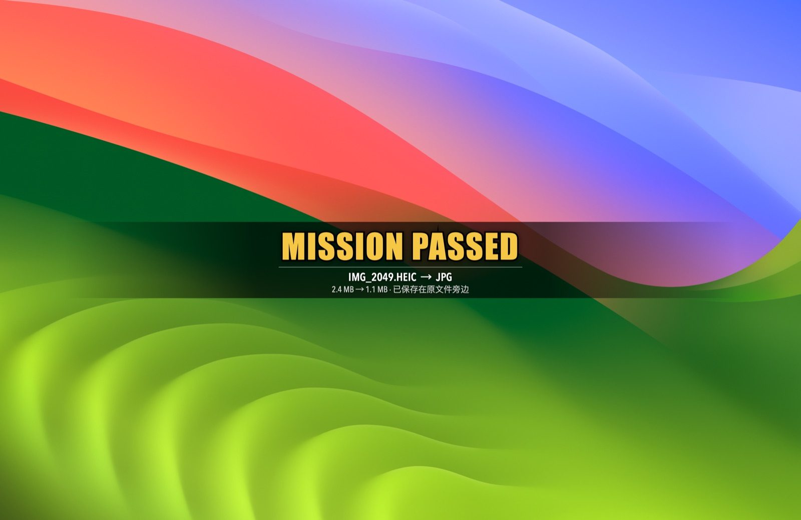
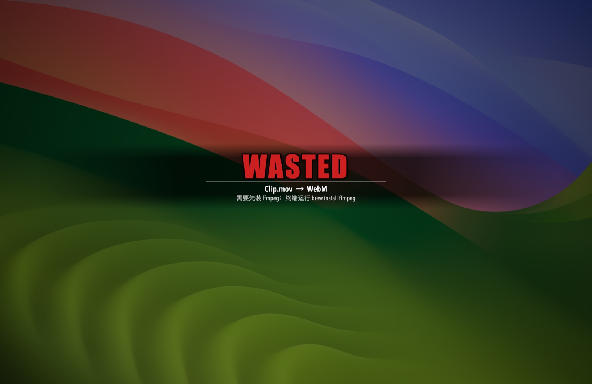

<p align="center">
  
</p>

<h1 align="center">格式轮盘 FormatWheel</h1>

<p align="center">
  <b>拖住文件，按一下 ⇧ Shift，朝格子一甩，松手 —— 转好了。</b><br>
  住在 macOS 菜单栏里的格式转换轮盘：图片、PDF、视频、音频、文档，70 多种转换和小工具，全程在本机完成。
</p>

<p align="center">
  <a href="https://github.com/Elise616/FormatWheel/releases/latest/download/FormatWheel.dmg"></a>
  &nbsp;
  <a href="https://elise616.github.io/FormatWheel/"></a>
</p>

<p align="center">macOS 14 及以上 · Apple 芯片 / Intel 通用 · 免费开源 · 不联网</p>

<p align="center">
  
</p>

## 宣传片

<a href="https://elise616.github.io/FormatWheel/#promo"></a>

点图片在网页里播放（40 秒，记得开声音），或者[直接下载 MP4](https://github.com/Elise616/FormatWheel/raw/main/docs/media/promo.mp4)。

## 安装

1. 下载 **[FormatWheel.dmg](https://github.com/Elise616/FormatWheel/releases/latest/download/FormatWheel.dmg)**，双击打开，把「FormatWheel」拖进「Applications」。
2. 第一次打开时 macOS 会拦一下（“无法验证开发者”）。这是个人做的免费开源小工具，没有付费给苹果做公证，不是病毒：
   - **macOS 14**：在「应用程序」里**右键**点 FormatWheel →「打开」→ 弹窗里再点「打开」。
   - **macOS 15 及以后**：先双击一次（会被拦下），然后打开「系统设置 → 隐私与安全性」，拉到下面点「仍要打开」，输入开机密码。
   - 还是打不开：打开「终端」，粘贴下面这行回车，再双击打开。

     ```bash
     xattr -dr com.apple.quarantine /Applications/FormatWheel.app
     ```
3. 打开后菜单栏会多一个小轮盘图标（Dock 里没有），第一次会自动演示一遍。

想自己编译？见[从源码构建](#从源码构建)。

## 怎么用

1. 在 Finder 或桌面上**拖住**一个或多个文件（先别松手），拖动中按一下 **⇧ Shift**：屏幕变暗，轮盘在鼠标位置弹出。
2. 朝想要的格子**方向**移动鼠标（方向对就行，不用拖到格子上），然后**松开鼠标**。
3. 结果存在原文件旁边，原文件不动。横幅会写明存到了哪；菜单栏「最近转换」里点一下就能在 Finder 里找到。

- 再按一次 Shift 翻到第 2 页「工具」；移回中心再松开 = 取消。
- 不想拖拽：菜单栏图标 →「选择文件打开轮盘…」，直接点格子（Esc / Tab / 滚轮也能用）。
- 成功：先响一声武器上膛，再弹 **MISSION PASSED**。失败：屏幕压暗 + **WASTED**，并告诉你怎么修。

## 轮盘里有什么

| 文件 | 第 1 页 · 格式转换 | 第 2 页 · 工具 |
| --- | --- | --- |
| 图片 | PNG · JPG · HEIC · WebP · PDF · AVIF · GIF · TIFF | 压缩 · 缩小一半 · 抠图 · 识字(OCR) · 黑白 · 旋转 · 去隐私 · 加背景 |
| PDF | PNG · JPG · 长图 · Word · TXT · Markdown · RTF · HTML | 压缩 · 拆页 · 合并 · 旋转 · 黑白 · 识字 · 去隐私 · ZIP |
| 视频 | MP4 · MOV · HEVC · WebM · GIF · MP3 · M4A · WAV | 压缩 · 静音 · 720P · 截封面 · 2 倍速 · 慢放 · 去隐私 · ZIP |
| 音频 | MP3 · M4A · WAV · FLAC · AIFF · Opus · ALAC · iPhone 铃声 | 压缩 · 单声道 · 响度统一 · 1.5 倍速 · ZIP · 复制路径 |
| 文档 | PDF · Word · TXT · Markdown · HTML · RTF · ODT · DOC | 字数统计 · 复制全文 · 去隐私(Word) · ZIP · 复制路径 |
| 其他 / 文件夹 | ZIP · 复制路径 · 复制文件名 · SHA-256 | |

多选图片时，PDF 格子会把它们合成一个 PDF。右上角属性条：白色是保留的、蓝色是提升、红色是牺牲的。

<table>
  <tr>
    <td></td>
    <td></td>
  </tr>
  <tr>
    <td></td>
    <td></td>
  </tr>
</table>

## 通缉星级

轮盘打开时，右上角会亮起通缉星：星越多，文件里能追踪到你的信息越多。

| 线索 | 星 |
| --- | --- |
| 照片 / 视频里的 GPS 定位 | ★★ |
| 手机或相机型号、拍摄时间、机身序列号 | 各 ★ |
| PDF 的作者 / 制作软件 / 主题关键词 | ★★ / ★ / ★ |
| Word 文档的作者 / 修改人 / 公司名 | ★★ / ★ / ★ |

指向「去隐私」格子时星星开始闪；松手后星星闪烁消失 = 甩掉警察。照片、视频、PDF、Word 都支持，不重新压缩画面。

转换、缩小一半、黑白、旋转会沿用照片里的 GPS 和拍摄信息（转成 WebP / AVIF / PDF 等格式时可能被丢弃）；要抹掉请再用「去隐私」。

## 两种格子图标

默认是「格式图标」：一眼看出格式本身的特点（PNG 带透明格、JPG 风景照、WebP 浏览器、TIFF 打印机……），格式名下面一行小字写着它的特点。菜单栏 →「格子图标」可以换成武器：PNG 突击步枪、JPG 手枪、PDF 火箭筒、抠图 匕首……

<table>
  <tr>
    <td></td>
    <td></td>
  </tr>
</table>

无论哪种图标，转换成功都会先响一声对应的上膛声：手枪拉套筒、步枪拉机柄、狙击枪拉栓、霰弹枪“咔嚓”、重武器上弹、手雷拔环、匕首出鞘、近战挥击。

<table>
  <tr>
    <td></td>
    <td></td>
  </tr>
</table>

## 可选：装上更多「弹药」

WebP 需要 cwebp；AVIF、WebM、MP3、Opus、视频变速、音频单声道 / 响度统一 / 倍速需要 ffmpeg。没装时这些格子显示「未装备」，其他格子照常能用。装了 [Homebrew](https://brew.sh) 的话一行搞定：

```bash
brew install ffmpeg webp
```

## 设置

都在菜单栏图标里：最近转换、格子图标（格式 / 武器）、角色配色（线上模式 / 麦克 / 富兰克林 / 崔佛）、轮盘大小、音效、背景虚化、完成横幅、登录时自动启动。

## 隐私

所有转换都在你的 Mac 上完成：不联网、不上传、不收集任何数据。结果只写在原文件旁边，日志在 `~/Library/Logs/FormatWheel.log`。

## 从源码构建

只需要 Xcode Command Line Tools（`xcode-select --install`），不用装 Xcode。

```bash
git clone https://github.com/Elise616/FormatWheel.git
cd FormatWheel
./build.sh     # → build/FormatWheel.app（本机架构）
./package.sh   # → dist/FormatWheel.dmg 和 .zip（Apple 芯片 + Intel 通用）
```

命令行模式方便测试（`FormatWheel` 指 `build/FormatWheel.app/Contents/MacOS/FormatWheel`）：

- `FormatWheel --ids` 列出全部动作，`FormatWheel --run img.to.png 照片.heic` 执行一个
- `FormatWheel --scan 照片.jpg`：看文件的通缉星级
- `FormatWheel --glyphs 图鉴.png` / `--weapons 图鉴.png`：导出全部格式图标 / 武器剪影
- `FormatWheel --sounds 文件夹`：导出全部音效 WAV

宣传片的画面也是用 App 自己的绘图代码逐帧渲染的（`./Promo/render.sh`，需要 ffmpeg），成片再剪辑配乐。

## 致谢

灵感来自 [@th2049 的这条推文](https://x.com/th2049/status/2111477585461039241)：拖文件 + 按 Shift 就能转格式。我们把它做成了一个轮盘。

## 许可

代码以 [MIT](LICENSE) 协议开源。`docs/media/promo.mp4` 仅作展示用途，其中背景音乐的版权归原作者所有。

这是一个致敬向的个人作品，与任何游戏公司无关：应用里的图标、武器剪影和音效全部由代码现画、现合成，没有使用任何游戏素材。

---

**English** — FormatWheel is a tiny macOS menu-bar app: drag files, tap ⇧ Shift, flick toward a slot on the wheel, release — converted. Images, PDF, video, audio and documents, 70+ actions, all on-device. [Download the DMG](https://github.com/Elise616/FormatWheel/releases/latest/download/FormatWheel.dmg) (macOS 14+, Apple silicon & Intel). On first launch: right-click → Open (macOS 14), or System Settings → Privacy & Security → Open Anyway (macOS 15+).
